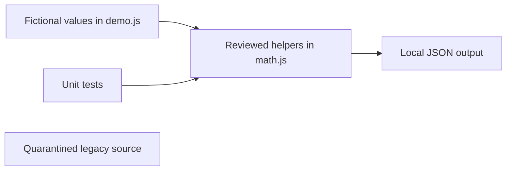

# MEXC / Binance Spread Research

**Portfolio category: Programming / Software Engineering.**

An offline research package derived from a two-exchange futures strategy. The original watches MEXC and Binance best bid/ask streams, compares differences in Binance tick-size steps, sizes a MEXC position and manages its closure. It contains actual order submission and shutdown liquidation code.

This repository's runnable component is an **offline demonstration**. The network-enabled source in `legacy/` stops immediately before loading dependencies, reading credentials or creating connections. There is no environment switch to enable it. This is not a paper-trading engine or a backtest.

## Problem and scope

Make selected existing algorithms inspectable and repeatable without exchange access, account credentials or real trades. Source provenance: `Flip.js.bak` from the original local portfolio.

## Implemented offline features

- Entry eligibility when both fee rates are known and neither is positive; unknown, blank or incorrectly typed rates block entry
- Contract-volume truncation and exchange quantity limits
- Gross linear-contract notional and directional PnL
- Missing, stale and future timestamp checks

## Technology and architecture

Runnable code uses CommonJS and Node built-ins only. Historical dependencies and services:

- axios and ws; Node built-ins crypto, fs and path
- MEXC web-session signing using MD5-derived headers; Binance public market data

Historical flow: MEXC / Binance WebSockets → freshness checks → entry/exit state machine → MEXC REST orders → position reconciliation and local logs.



## Requirements and installation

Use Node.js 18 or later and npm. There are no runtime package dependencies for the offline commands; no install is required.

From this repository's directory:

```sh
npm run check
npm test
npm run demo
```

`src/demo.js` is the example input and output entry point. Change only fictional values to explore helper behavior. Demos do not load the legacy source or any credential file.

## Configuration

Offline examples require no configuration. `.env.example` lists fictional placeholders for historical adapters. `src/config.js` reads environment variables but does not automatically parse `.env`; environment values must be explicitly exported by the caller. It is not imported by the offline demo. Do not add real values to examples, source files or commits.

## Security considerations

No exchange permissions are needed for the offline package. The legacy web-session authentication is not treated as a verified supported public API.

The original automatically installed dependencies during startup; that behavior has been removed in the copy. The unconditional legacy guard also blocks trade submission and network notification paths. Removing that guard is a separate engineering task requiring review and simulated integration tests. Do not run original trading scripts for a syntax check.

## Testing and verification

5 calculation test cases passed locally with Node.js 24.14.0. `npm run check`, `npm test` and `npm run demo` completed successfully. Tests cover the public examples and selected helpers; they do not exercise the exchange state machine. The [GitHub Actions workflow](https://github.com/Psiblame/mexc-binance-spread-research/actions/workflows/check.yml) runs these offline checks on pushes and pull requests.

## Known limitations

- Original computeVol receives bookCap but does not use it; depth-based sizing remains incomplete.
- Original high leverage, fixed reconnect delay and shutdown order submission require simulation before use.
- Gross PnL helpers exclude fees, funding, slippage and realized fill differences.
- JavaScript Number arithmetic remains approximate; basic helper domains are narrower than a financial library.

## Future improvements

Separate exchange transport from strategy state, record synthetic fill events and test retry/reconnect paths deterministically. Introduce decimal or fixed-point arithmetic before interpreting results as financial calculations. Resolve, audit and lock historical dependencies before adding any network adapter.

## Repository scope and licensing

This repository contains a sanitized source snapshot and offline helpers. The original Git history is not included. No license has been selected. The network runtime remains unsupported.
